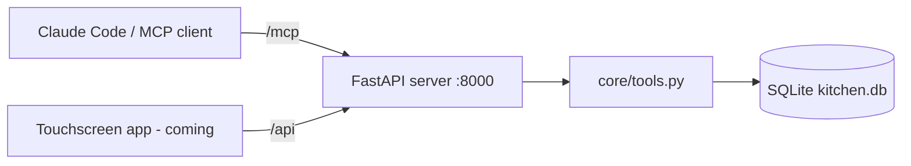

# Kitchen Hub

A kitchen assistant that runs on a Raspberry Pi with a touchscreen. It keeps track of your **pantry**, **meal plan** and **grocery list**, and lets Claude manage all three through an [MCP](https://modelcontextprotocol.io) server.

> **Status:** the data layer, REST API and MCP server work today. The touchscreen app, the "plan my week" agent and receipt scanning are coming next (see [Roadmap](#roadmap)).

## What it does

- **Pantry:** what you have, how much, and when it expires. Shows what to use soon.
- **Meal plan:** breakfast, lunch, dinner and snacks by day, with optional recipes.
- **Grocery list:** add and check off items. Adding something already on the list merges it instead of creating a duplicate.
- **Claude integration:** any MCP client, such as Claude Code, can read and change all of the above. Ask "what's expiring this week?" or "add milk and eggs to the grocery list".

## How it works



- **`core/tools.py`** holds every kitchen action (add an item, set a meal, check off a grocery). Each piece of the app calls these same functions, so the logic lives in one place.
- **`server/app.py`** is a single FastAPI server that exposes those functions two ways: as an MCP server at `/mcp` for Claude, and as a small REST API at `/api` for the touchscreen.
- **`core/db.py`** stores everything in a single SQLite file. The tables are created automatically the first time it runs.

## What you need

- **Python 3.13**
- To use it with Claude: **Claude Code**, or another MCP client that supports HTTP servers
- For the kitchen display (later): a **Raspberry Pi Zero 2 W or newer** and a touchscreen. The project is built on a 7" 1024x600 screen.

## Setup

1. **Clone and enter the repo:**
   ```bash
   git clone <repo-url> kitchen-hub
   cd kitchen-hub
   ```

2. **Create a virtual environment and install dependencies.**

   Windows:
   ```bash
   py -3.13 -m venv venv
   venv\Scripts\python -m pip install -r requirements.txt
   ```

   Linux / Raspberry Pi:
   ```bash
   python3 -m venv venv --system-site-packages
   venv/bin/python -m pip install -r requirements.txt
   ```

3. **Create your `.env` file.** Copy `.env.example` to `.env`, then set `KITCHEN_TOKEN` to a random value:
   ```bash
   venv/Scripts/python -c "import secrets; print(secrets.token_urlsafe(32))"
   ```
   `.env` is gitignored. Never commit it or paste the token anywhere public.

4. **Run the tests:**
   ```bash
   venv/Scripts/python -m tests.test_tools
   venv/Scripts/python -m tests.test_server
   ```
   Use `venv/bin/python` on Linux. Every line should end in `ok`.

5. **Start the server:**
   ```bash
   venv/Scripts/python -m uvicorn server.app:app --env-file .env --host 0.0.0.0 --port 8000
   ```
   The server refuses to start without a `KITCHEN_TOKEN` of at least 32 characters. Interactive API docs are at http://localhost:8000/docs.

## Connect Claude

With the server running, register it with Claude Code:

```bash
claude mcp add --transport http kitchen http://localhost:8000/mcp --header "Authorization: Bearer <your KITCHEN_TOKEN>"
```

This saves the token in your local Claude Code config, not in the repo.

From another device, replace `localhost` with the server's hostname (for example its Tailscale name). Then try:

- "Add 2 litres of milk expiring Friday to the pantry"
- "Plan dinners for this week using what's expiring"
- "What's on my grocery list?"

### MCP tools

| Tool | What it does |
|---|---|
| `get_pantry` | List pantry items, soonest-expiring first |
| `add_pantry_items` | Add items (name, qty, unit, category, expiry) |
| `use_pantry_item` | Use part of an item, or remove it entirely |
| `get_expiring` | Items expiring within N days, including already expired |
| `get_meal_plan` | Meals for a range of days |
| `set_meal` | Plan a meal in a slot, replacing what was there |
| `remove_meal` | Remove a planned meal |
| `get_grocery_list` | The grocery list, optionally including checked items |
| `add_grocery_items` | Add items, merging any already on the list |
| `check_grocery_item` | Check or uncheck an item |
| `clear_checked_groceries` | Delete checked-off items |

### REST API

| Method | Path | Returns |
|---|---|---|
| GET | `/api/pantry` | All pantry items |
| GET | `/api/expiring?days=3` | Items expiring soon |
| GET | `/api/meals?start=YYYY-MM-DD&days=7` | Meal plan (start defaults to today) |
| GET | `/api/grocery?include_checked=false` | Grocery list |
| POST | `/api/grocery/{id}/check?checked=true` | Check or uncheck an item |

Every request needs the header `Authorization: Bearer <KITCHEN_TOKEN>`; without it you get `401`. Bad input (an unknown id, a malformed date) returns `400` with a `detail` message.

## Configuration

| Setting | Default | Purpose |
|---|---|---|
| `KITCHEN_TOKEN` | none (required) | Bearer token every REST and MCP request must send |
| `KITCHEN_DB` | `kitchen.db` in the repo folder | Where the SQLite database lives |

Settings are read from `.env` (see `.env.example`).

## Security

- **Secrets stay local.** Tokens and API keys live only in `.env` (gitignored) or the Pi's service environment, never in the code or the repo.
- **Every request is authenticated.** `/api` and `/mcp` require the bearer token (compared in constant time). Only `/docs` and `/openapi.json` are open, and they describe the API, not your data.
- **Network.** Even with the token, run the server only on your home network or a private network like Tailscale. Don't port-forward it to the internet.
- **Database.** `kitchen.db` is gitignored and never leaves the device except in your own backups.

## Project layout

```
core/db.py          SQLite schema and connection
core/tools.py       Every kitchen action (shared by MCP, REST and the UI)
server/app.py       FastAPI server: REST at /api, MCP at /mcp
tests/              Tests for the tools and the token check (temporary databases)
.env.example        The settings you need, with no values
requirements.txt    Pinned Python dependencies
```

## Roadmap

- [x] Pantry, meal plan and grocery data with tests
- [x] REST API and MCP server
- [ ] Touchscreen app for the kitchen (Kivy): today's meals, grocery list, pantry, step-by-step cook mode
- [ ] "Plan my week" button: Claude builds a meal plan from what's in the pantry
- [ ] Receipt scanning: photograph a receipt and Claude adds the items to the pantry with expiry dates
- [ ] Runs as a service on the Pi, with nightly backups
- [ ] Remote access from your phone via Tailscale
