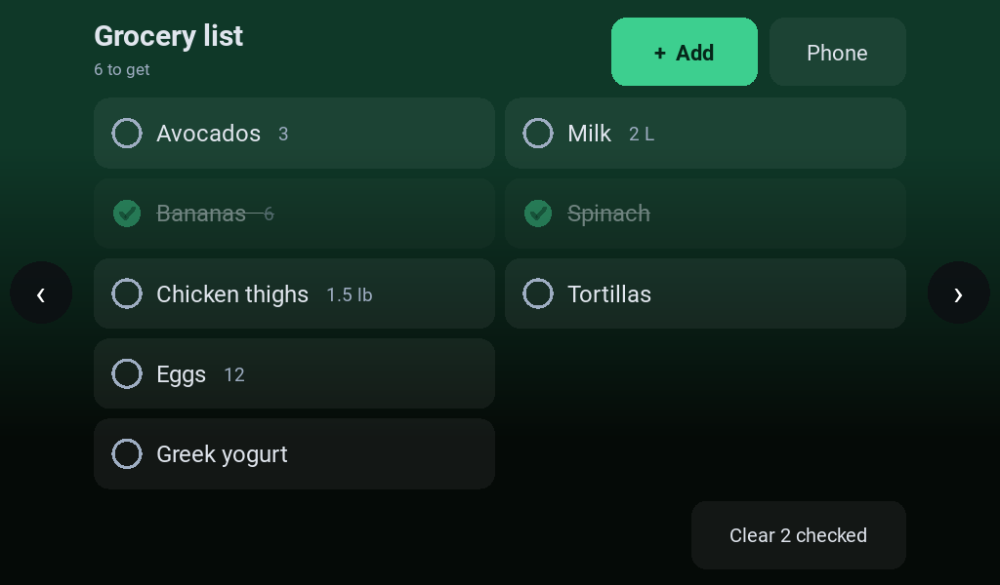
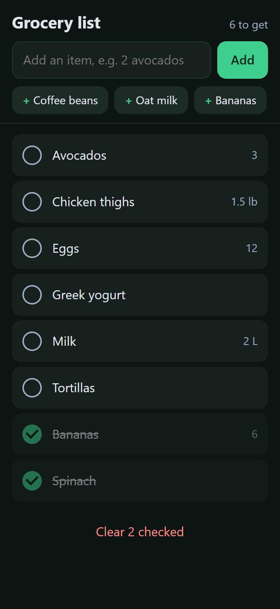
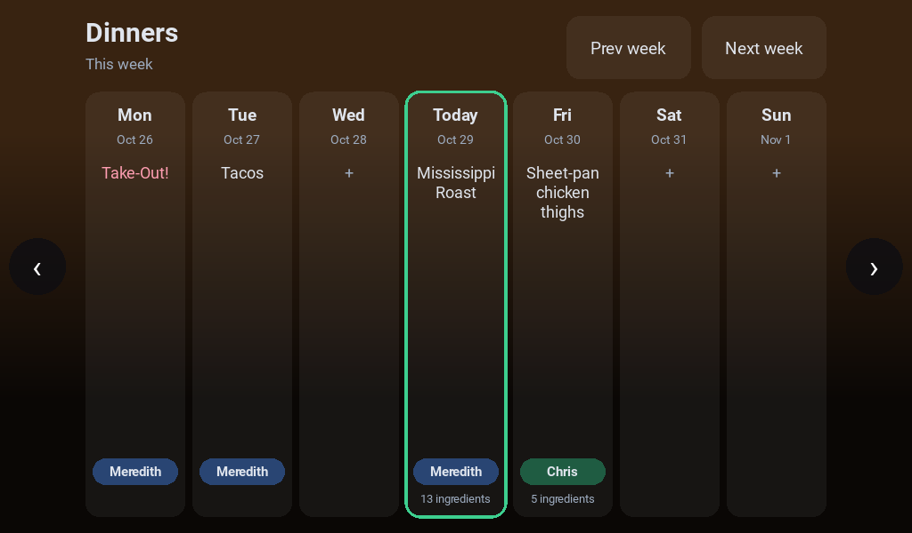
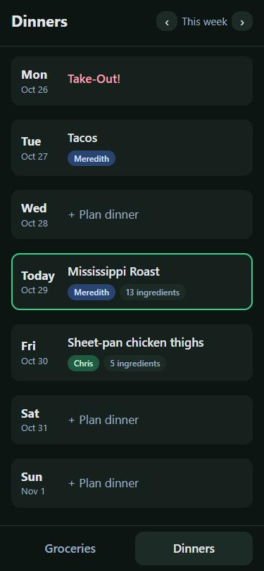
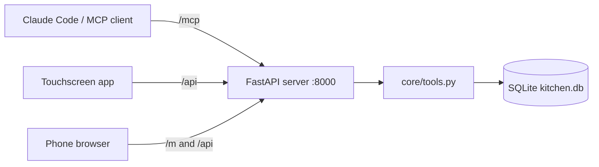
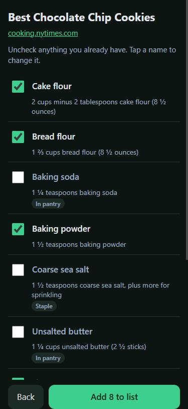
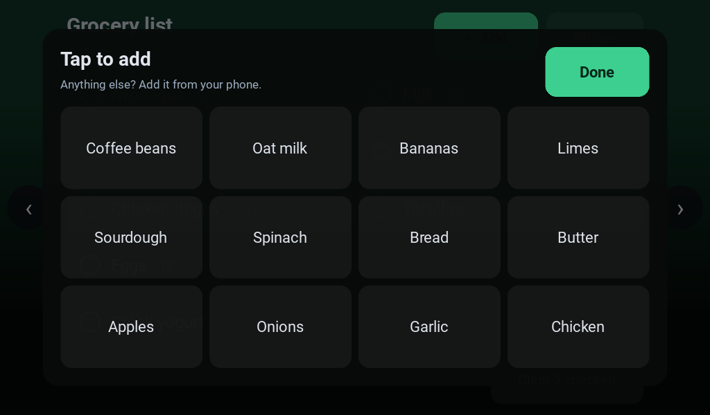
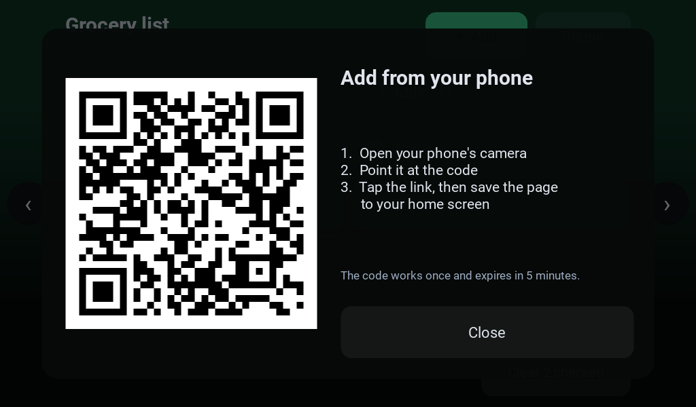
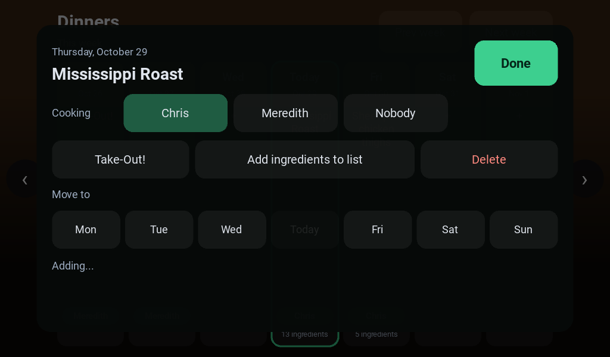

# Kitchen Hub

A kitchen assistant that runs on a Raspberry Pi with a touchscreen. It keeps track of your **pantry**, **meal plan** and **grocery list**, and lets Claude manage all three through an [MCP](https://modelcontextprotocol.io) server.

> **Status:** the grocery list and the weekly dinner plan work end to end today: on the touchscreen, on your phone, and through Claude. The "plan my week" agent and receipt scanning are coming next (see [Roadmap](#roadmap)).

| Kitchen touchscreen | Your phone |
|---|---|
|  |  |
|  |  |

## What it does

- **Pantry:** what you have, how much, and when it expires. Shows what to use soon.
- **Dinner plan:** one dinner a day, Monday to Sunday. Each dinner can have a recipe (from a link or pasted ingredients), a cook and notes, or be a **Take-Out!** night with a note on where to order from (take-out nights don't get a cook). Move a dinner to another day (if that day is taken, the two swap) or delete it. One tap adds a dinner's ingredients to the grocery list, leaving out what's already in the pantry. Who can cook comes from `KITCHEN_COOKS` in your `.env`, so names stay out of the code.
- **Grocery list:** add and check off items. Adding something already on the list merges it instead of creating a duplicate, and re-adding something you checked off brings it back.
- **Touchscreen app:** a big-button kitchen display. Tap an item to check it off; it dims in place so nothing moves under your finger. **+ Add** shows one-tap buttons for the things you buy most. The **Dinners** screen shows the week. Tap a day to pick who's cooking, make it take-out, add its ingredients to the list, move it or delete it.
- **Phone page:** tap **Phone** on the touchscreen and scan the QR code. Your phone gets the grocery list with a text box for adding anything, suggestion chips, and check-offs. Type `2 avocados` and it records the quantity. Save it to your home screen and it works like an app. The **Dinners** tab is the planner: tap a day to set the meal, paste its recipe, pick the cook or choose another day. After you save a dinner with a new recipe, its ingredient checklist opens so you can add what you need.
- **Recipe import:** on the phone page, tap **Recipe** and paste a recipe link (NYT Cooking and most recipe sites work) or an ingredient list. You get a checklist of grocery items, cleaned up from lines like "2 cups minus 2 tablespoons cake flour" to "Cake flour". Anything already in your pantry, and staples like salt and water, start unchecked. You can rename items before adding them.
- **Claude integration:** any MCP client, such as Claude Code, can read and change all of the above. Ask "what's expiring this week?" or "add milk and eggs to the grocery list".

## How it works



- **`core/tools.py`** holds every kitchen action (add an item, set a meal, check off a grocery). Each piece of the app calls these same functions, so the logic lives in one place.
- **`server/app.py`** is a single FastAPI server that exposes those functions two ways: as an MCP server at `/mcp` for Claude, and as a small REST API at `/api` for the touchscreen.
- **`server/phone.py`** handles pairing phones and serves the phone page (`server/static/`). Plain HTML, CSS and JavaScript, with no build step and no outside requests.
- **`ui/`** is the Kivy touchscreen app. It only talks to the server's REST API, always from a background thread so taps never freeze while the network is slow.
- **`core/db.py`** stores everything in a single SQLite file. The tables are created automatically the first time it runs.

## What you need

- **Python 3.13**
- To use it with Claude: **Claude Code**, or another MCP client that supports HTTP servers
- For the touchscreen app: **Kivy 2.3** and a screen. The project is built on a **Raspberry Pi Zero 2 W** with a 7" 1024x600 touchscreen, and also runs in a window on Windows for development.

## Setup

1. **Clone and enter the repo:**
   ```bash
   git clone <repo-url> kitchen-hub
   cd kitchen-hub
   ```

2. **Create a virtual environment and install dependencies.**

   Windows:
   ```bash
   py -3.13 -m venv venv
   venv\Scripts\python -m pip install -r requirements.txt
   ```

   Linux / Raspberry Pi:
   ```bash
   python3 -m venv venv --system-site-packages
   venv/bin/python -m pip install -r requirements.txt
   ```

3. **Create your `.env` file.** Copy `.env.example` to `.env`, then set `KITCHEN_TOKEN` to a random value:
   ```bash
   venv/Scripts/python -c "import secrets; print(secrets.token_urlsafe(32))"
   ```
   `.env` is gitignored. Never commit it or paste the token anywhere public.

4. **Run the tests:**
   ```bash
   venv/Scripts/python -m tests.test_tools
   venv/Scripts/python -m tests.test_server
   venv/Scripts/python -m tests.test_recipes
   ```
   Use `venv/bin/python` on Linux. Every line should end in `ok`.

5. **Start the server:**
   ```bash
   venv/Scripts/python -m uvicorn server.app:app --env-file .env --host 0.0.0.0 --port 8000
   ```
   The server refuses to start without a `KITCHEN_TOKEN` of at least 32 characters. Interactive API docs are at http://localhost:8000/docs.

6. **Start the touchscreen app** (in a second terminal, with the server running).

   Install Kivy first. It isn't in `requirements.txt` because the Pi gets it from apt:
   - Windows: `venv\Scripts\python -m pip install kivy`
   - Raspberry Pi: `sudo apt install python3-kivy` (the venv sees it through `--system-site-packages`)

   Then run:
   ```bash
   venv/Scripts/python -m ui.main
   ```
   It opens a 1024x600 window on Windows and goes fullscreen on Linux. It reads the same `.env`, so it uses your token automatically.

7. **Connect your phone.** Tap **Phone** on the touchscreen and scan the code with your phone's camera. Your phone has to be on the same network as the server (or on Tailscale). Then use your browser's "Add to Home Screen". By default the QR code points to the server's local IP address.

   **Give it a friendly name (optional):** add a local DNS record so phones can reach the server as, for example, `kitchen.lan`:
   - **Pi-hole:** Settings → Local DNS Records (v6) or Local DNS → DNS Records (v5). Add domain `kitchen.lan` pointing to the server's IP.
   - **No Pi-hole:** most routers have a similar "local DNS" or "hostname" setting.

   Then set `KITCHEN_PUBLIC_URL=http://kitchen.lan:8000` in `.env` and restart the server. Phones paired at the old address need to scan a new code, because a phone's login is tied to the address it paired with. Phones need to use that DNS server (Pi-hole) for the name to work.







## Run it on a Raspberry Pi

The kitchen display is a Raspberry Pi Zero 2 W with a 7" touchscreen. One script installs everything, and after that it all starts on boot.

```bash
sudo apt-get install -y git
git clone https://github.com/<you>/kitchen-hub.git ~/kitchen-hub
cd ~/kitchen-hub
./deploy/install-pi.sh
sudo reboot
```

The installer:
- installs Kivy and prebuilt copies of the compiled Python dependencies from apt, so nothing has to compile on the Pi. If the MCP SDK's dependencies still won't install, it falls back to Debian's FastAPI and runs without `/mcp`; the touchscreen and phones keep working.
- creates `.env` with a new token if you don't have one. To keep the same token as another machine, copy that `.env` over first.
- runs the server as the `kitchen-hub-api` systemd service, which starts on boot and restarts if it stops.
- starts the touchscreen app at desktop login (the Pi needs desktop autologin, set in `raspi-config`). The app waits for the server, runs fullscreen with the mouse cursor hidden, and restarts if it crashes.

Turn off screen blanking (`raspi-config` → Display Options) so the display stays on.

| Need to | Run |
|---|---|
| Update to the latest code | `cd ~/kitchen-hub && git pull && ./deploy/install-pi.sh` |
| See server logs | `journalctl -u kitchen-hub-api -n 50` |
| See touchscreen app logs | `cat ~/.kitchen-hub-ui.log` |
| Restart the server | `sudo systemctl restart kitchen-hub-api` |

## Connect Claude

With the server running, register it with Claude Code:

```bash
claude mcp add --transport http kitchen http://localhost:8000/mcp --header "Authorization: Bearer <your KITCHEN_TOKEN>"
```

This saves the token in your local Claude Code config, not in the repo.

From another device, replace `localhost` with the server's hostname (for example its Tailscale name). Then try:

- "Add 2 litres of milk expiring Friday to the pantry"
- "Plan dinners for this week using what's expiring"
- "What's on my grocery list?"

### MCP tools

| Tool | What it does |
|---|---|
| `get_pantry` | List pantry items, soonest-expiring first |
| `add_pantry_items` | Add items (name, qty, unit, category, expiry) |
| `use_pantry_item` | Use part of an item, or remove it entirely |
| `get_expiring` | Items expiring within N days, including already expired |
| `get_meal_plan` | Meals for a range of days |
| `set_meal` | Plan a meal in a slot with an optional recipe, cook, notes and take-out flag, replacing what was there |
| `remove_meal` | Remove a planned meal |
| `get_grocery_list` | The grocery list, optionally including checked items |
| `add_grocery_items` | Add items, merging any already on the list |
| `check_grocery_item` | Check or uncheck an item |
| `clear_checked_groceries` | Delete checked-off items |
| `get_frequent_groceries` | Suggest items to re-add: the most bought first, then common staples |
| `get_cooks` | Who can be assigned to cook |
| `move_meal` | Move a dinner to another day, swapping if that day is taken |
| `get_meal_ingredients` | A dinner's ingredients as grocery items, flagging pantry items and staples |
| `read_recipe` | Read a recipe link or pasted ingredients into grocery items, flagging pantry items and staples (adds nothing) |

### REST API

| Method | Path | Returns |
|---|---|---|
| GET | `/api/pantry` | All pantry items |
| GET | `/api/expiring?days=3` | Items expiring soon |
| GET | `/api/meals?start=YYYY-MM-DD&days=7` | Meal plan (start defaults to today) |
| PUT | `/api/meals/{date}` | Set that day's dinner, body: `{"title", "cook", "takeout", "notes", "recipe"}` |
| DELETE | `/api/meals/{date}` | Delete that day's dinner |
| POST | `/api/meals/{date}/move?to=YYYY-MM-DD` | Move a dinner, swapping if the target day is taken |
| GET | `/api/meals/{date}/ingredients` | The dinner's ingredients as grocery items |
| GET | `/api/cooks` | Who can be assigned to cook |
| GET | `/api/grocery?include_checked=false` | Grocery list |
| POST | `/api/grocery` | Add items, body: `[{"name": "Milk", "qty": 2, "unit": "L"}]` |
| GET | `/api/grocery/frequent?limit=12` | Suggested items to re-add |
| POST | `/api/recipes/read` | Body `{"link_or_text": "..."}`: the recipe's title, ingredients as grocery items, and steps |
| POST | `/api/grocery/{id}/check?checked=true` | Check or uncheck an item |
| POST | `/api/grocery/clear-checked` | Delete checked-off items |

| POST | `/api/pair` | One-time QR pairing link for a phone (token only) |
| POST | `/api/phones/revoke-all` | Sign out every paired phone (token only) |

Every request needs the header `Authorization: Bearer <KITCHEN_TOKEN>` (or, for `/api` routes other than the two marked "token only", a paired phone's session cookie); without it you get `401`. Bad input (an unknown id, a malformed date) returns `400` with a `detail` message.

## Configuration

| Setting | Default | Purpose |
|---|---|---|
| `KITCHEN_TOKEN` | none (required) | Bearer token every REST and MCP request must send |
| `KITCHEN_DB` | `kitchen.db` in the repo folder | Where the SQLite database lives |
| `KITCHEN_API` | `http://127.0.0.1:8000` | Server address the touchscreen app talks to |
| `KITCHEN_COOKS` | none | Comma-separated names that can be assigned to cook dinner, such as `Alex,Sam` |
| `KITCHEN_PUBLIC_URL` | `http://<server's local IP>:8000` | Address phones use, put in the pairing QR code. Set it to the Pi's Tailscale name so phones work away from home too. |

Settings are read from `.env` (see `.env.example`).

## Security

- **Secrets stay local.** Tokens and API keys live only in `.env` (gitignored) or the Pi's service environment, never in the code or the repo.
- **Every request is authenticated.** `/api` and `/mcp` require the bearer token (compared in constant time). Only `/docs`, `/openapi.json` and the phone page's empty shell are open, and none of them contain your data.
- **Phones never see the token.** Pairing uses a random one-time code that expires after 5 minutes. Scanning it gives the phone its own session cookie (`HttpOnly`, `SameSite=Lax`), stored only as a SHA-256 hash on the server. Phone sessions can use the grocery API but not `/mcp` or pairing. If a phone is lost, sign them all out:
  ```bash
  curl -X POST -H "Authorization: Bearer <KITCHEN_TOKEN>" http://localhost:8000/api/phones/revoke-all
  ```
- **The phone page is locked down.** It has a strict Content-Security-Policy, renders item names as text and never as HTML, and refuses to be framed.
- **Recipe links are fetched carefully.** Only `http`/`https` links on the standard ports are fetched, and only when every address the host resolves to is a public internet address, checked again on every redirect. That means a link can't be used to reach the Pi itself, Pi-hole or anything else on your network. Pages are capped at 3 MB (including after decompression), with a 10-second timeout. The server identifies itself honestly as `KitchenHub/1.0`, fetches only the page you asked for, and never signs in to any site.
- **Input is validated.** Item names are trimmed and limited to 80 characters, and dates and meal slots are checked.
- **Network.** Even with the token, run the server only on your home network or a private network like Tailscale. Don't port-forward it to the internet.
- **Database.** `kitchen.db` is gitignored and never leaves the device except in your own backups.

## Project layout

```
core/db.py          SQLite schema and connection
core/tools.py       Every kitchen action (shared by MCP, REST and the UI)
core/recipes.py     Reads recipe pages (schema.org data) and pasted lists, cleans up ingredient names
server/app.py       FastAPI server: REST at /api, MCP at /mcp, auth
server/phone.py     Phone pairing, sessions and the phone page
server/static/      Phone page HTML, CSS and JavaScript (mobile.js groceries, meals.js dinners)
ui/main.py          Touchscreen app: screens, arrows, screen-name badge
ui/grocery_screen.py  Grocery list screen
ui/dinners_screen.py  Dinners week screen and its day panel
ui/panels.py        Quick add and phone pairing pop-ups
ui/clock_screen.py  Clock screen
ui/api.py           Background-thread REST client for the app
ui/ui_common.py     Shared look: gradients, cards, buttons, tap debounce
tests/              Tests for the tools, recipes, auth and phone pairing (temporary databases)
docs/               Screenshots
.env.example        The settings you need, with no values
deploy/             Pi installer, systemd service, touchscreen autostart
requirements.txt    Pinned Python dependencies
```

## Roadmap

- [x] Pantry, meal plan and grocery data with tests
- [x] REST API and MCP server
- [x] Touchscreen app with the grocery list and a clock
- [x] Add from your phone (QR pairing) and one-tap quick add
- [x] Import ingredients from a recipe link (NYT Cooking and others) or a pasted list
- [ ] Claude cleans up trickier ingredient lines and merges duplicates across recipes
- [x] Weekly dinner planner: recipes, cooks, take-out nights, move and delete, ingredients to the list
- [ ] More screens: pantry, step-by-step cook mode from a dinner's recipe
- [ ] "Plan my week" button: Claude builds a meal plan from what's in the pantry
- [ ] Receipt scanning: photograph a receipt and Claude adds the items to the pantry with expiry dates
- [x] One-step Pi install; server and touchscreen app start on boot
- [ ] Nightly backups
- [ ] Remote access from your phone via Tailscale
